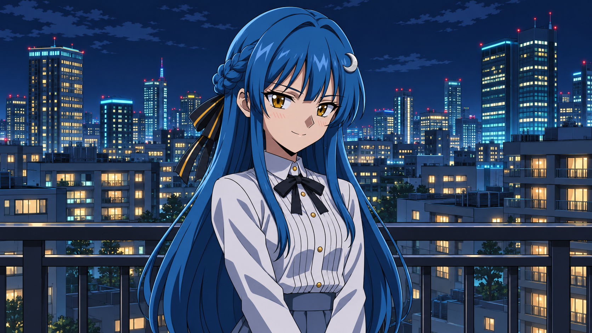

# 原画方向与方案索引

## 早期美术探索方向

- 引擎：Godot。
- 类型：二次元放置陪伴游戏，在不同景色中与玩家对视。
- 角色：可爱、娇小，蓝色长发、金色眼睛；参考用户提供动画画面的线稿和赛璐璐阴影。
- 当前场景：阳台上的站姿半身近景，不显示腿部或地板。
- 构图：自然对视，身后有阳台栏杆，城市夜景建筑和窗户灯光需要清晰可见。
- 当时探索目标：增强年代感与风格化程度。后续已转向柔光雪夜风格。

## 已认可的基础构图

用户已认可此图的方向，随后要求基于它提供五个更具年代感的方案。

## 历史五个风格方案

以下编号对应当时的生成顺序，作为历史候选方案保留。

| 编号 | 风格方向 | 主要区别 | 原画 |
| --- | --- | --- | --- |
| 01 | 80 年代手绘 OVA | 克制的高光、偏暖肤色、手绘背景和细颗粒质感 | [查看](style-options/01-1980s-ova.png) |
| 02 | 90 年代赛璐璐动画 | 高饱和深蓝、明确色块、利落发丝与眼部线条 | [查看](style-options/02-1990s-cel.png) |
| 03 | 90 年代少女漫画彩稿 | 纤细排线、柔和紫调、纸面与彩墨质感 | [查看](style-options/03-1990s-shoujo.png) |
| 04 | 早期视觉小说 CG | 清晰细线、明亮眼睛、鲜明发丝高光 | [查看](style-options/04-2000s-visual-novel.png) |
| 05 | 复古都市科幻动画 | 大面积深色阴影、青色轮廓光、密集科幻楼宇 | [查看](style-options/05-retro-scifi.png) |

## 历史探索

- [最初十个场景方案图板](archive/01-ten-scene-concepts.png)：咖啡馆、海边车站、樱花庭院、壁炉小屋、都市天台、森林溪流、图书馆、海景房、湖畔露营、玻璃花房。
- [阳台全身站姿](archive/02-balcony-full-body.png)：历史版本，后续已改为半身。
- [简化背景的阳台半身](archive/03-balcony-half-body.png)：历史版本，后续已要求清晰城市夜景。

## 文件与制作状态

本目录收录早期探索的 9 张 PNG，复制时已逐一校验 SHA-256，原始生成文件仍保留在工作区 `/workspace/generated_images/`。

这些是早期合并后的概念图，尚非动画分层素材。后续已基于用户选定的柔光雪夜蓝发女主图制作 Godot 循环动画原型，运行及预览见[项目说明](../../README.md)。本目录保留早期探索历史，不代表当前动画的最终美术选择。

用户提供的动画参考截图保留在会话中，未作为仓库内的素材文件归档。
